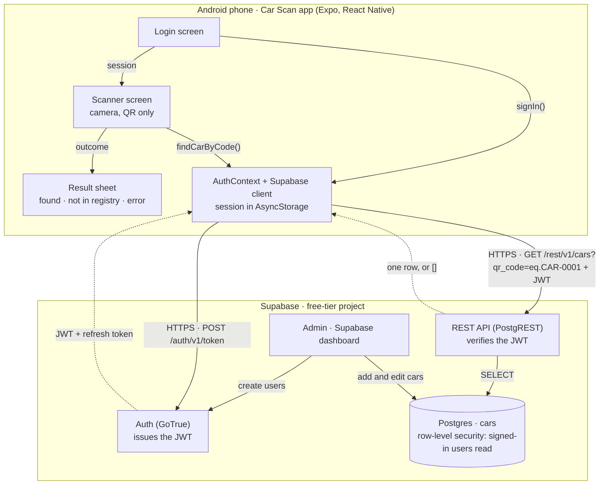

# Car Scan architecture

A text version of the architecture. GitHub and VS Code (with a Mermaid preview extension) render the diagrams below.

## System overview



The phone only reads. Cars and users are added by an admin in the Supabase dashboard, which is the only write path today.

## One scan, end to end

```mermaid
sequenceDiagram
  participant Cam as Camera
  participant Scr as Scanner screen
  participant Cli as Supabase client
  participant SB as Supabase (API + Postgres)

  Cam->>Scr: onBarcodeScanned("CAR-0001")
  Note over Scr: scan lock: one decode = one lookup
  Scr->>Cli: findCarByCode(code)
  Note over Cli: trim; skip the call if empty or over 200 chars
  Cli->>SB: GET /cars?qr_code=eq.CAR-0001 (Bearer JWT)
  Note over SB: RLS: signed-in users may SELECT
  SB-->>Cli: [ row ] or [ ]
  Cli-->>Scr: Car | null (throws on network or DB error)
  Scr->>Scr: show result sheet + haptic
```

| Reply | What the user sees |
| --- | --- |
| One row | Registered-vehicle card: plate, year, make, model, colour, owner, status badge |
| Empty list | "Car not in registry" plus the scanned text |
| Error (no signal, paused project, server error) | Error sheet with Retry, which repeats the same lookup |

## Build and share

1. Edit in VS Code and test with `npx expo start` in Expo Go.
2. Push to GitHub.
3. `eas build -p android --profile preview` builds an APK on Expo's cloud. The Supabase URL and anon key come from EAS environment variables.
4. EAS gives an install link on expo.dev.
5. Testers install the APK and sign in with an account created in Supabase.

## Components

| Piece | Job | File |
| --- | --- | --- |
| App shell | Setup hint, spinner, login or scanner depending on keys and session | `App.tsx` |
| AuthContext | Restores the saved session; `signIn`, `signOut` | `src/context/AuthContext.tsx` |
| Supabase client | Reads the `EXPO_PUBLIC` keys, stores the session in AsyncStorage, refreshes the token while the app is in the foreground | `src/lib/supabase.ts` |
| Registry lookup | `findCarByCode` returns a car or null, throws on errors | `src/lib/cars.ts` |
| Login screen | Email and password form | `src/screens/LoginScreen.tsx` |
| Scanner screen | QR-only camera, scan lock, flashlight, permission states | `src/screens/ScannerScreen.tsx` |
| Result sheet | Found, not-in-registry, loading and error views | `src/components/ResultSheet.tsx` |
| Schema | `cars` table, read-only policy, sample rows | `supabase/schema.sql` |
| Build config | Package name, camera permission text, APK profile | `app.json`, `eas.json` |

## Data and security

The `cars` table: `id`, `qr_code` (unique, the exact text in the QR), `plate_number`, `make`, `model`, `year`, `color`, `owner_name`, `status` (`active`, `expired`, `suspended`), `notes`, `created_at`.

What protects it:

- The anon key in the app is public by design and grants nothing without a login.
- Row-level security is on with one policy: signed-in users may `SELECT`. There is no insert, update or delete policy, so the app cannot change data.
- Sign-up should be switched off in Supabase so only accounts you create can sign in.
- All traffic uses HTTPS.

Gaps to know about:

- Every signed-in user can read every field of every car, including owner names.
- The session token is in AsyncStorage, which is not encrypted. SecureStore is the upgrade.
- The QR code holds a plain ID. A copied code passes as the real car, because nothing signs it.

## Trade-offs

- **Expo and Supabase.** Gained: editing in VS Code, testing in Expo Go, and login, database and access rules in one free service. Cost: a new icon, permission or native module needs a new APK build.
- **The QR holds an ID, not the data.** Gained: owners and statuses change without reprinting labels. Cost: no signal means no answer, and the ID alone proves nothing about the car.
- **Read-only app.** Gained: the smallest attack surface for a trial. Cost: nobody can add a car on site until a role system exists.
- **Free tier.** Gained: a pilot at no cost. Cost: free Supabase projects can be paused after a stretch of inactivity, so check their current limits before a real rollout.

## Where it grows

| Feature | Architecture change |
| --- | --- |
| Scan history | `scan_logs` table (code, user, result, time) with an insert policy; the app writes one row per lookup |
| Roles | `profiles` table with a role column; RLS policies check it; admin-only screens |
| Add and edit cars in the app | Insert and update policies for admins, plus a form screen |
| Car photos | Supabase Storage bucket and a `photo_url` column |
| Offline mode | Local SQLite copy of the registry, refreshed in the background; lookup tries it first |
| Plate reading | On-device text recognition feeding a lookup on `plate_number` |
| Fixes without a new APK | EAS Update for JavaScript changes |
| Alerts | Database trigger or Edge Function when a `scan_logs` row belongs to a suspended car |
